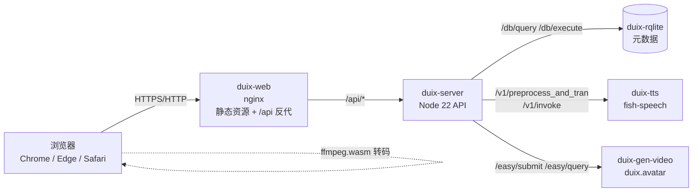

# Duix.Avatar Web 部署指南

本文说明如何把 Duix.Avatar 以 **Web 服务** 的方式部署：浏览器访问、无 Electron 客户端、
不安装 ffmpeg 二进制、元数据存到 rqlite、一条 `docker compose up -d` 起全栈。

---

## 1. 架构



组件职责：

| 组件 | 镜像 | 作用 |
| --- | --- | --- |
| `duix-web` | 本地构建 `duix-avatar-web` | 前端静态资源 + `/api` 反向代理 |
| `duix-server` | 本地构建 `duix-avatar-server` | REST API、rqlite 访问、媒体存储、任务队列 |
| `duix-rqlite` | `rqlite/rqlite:8.36.2` | 元数据（模特/作品/音色/配置），HTTP + Raft 复制 |
| `duix-tts` | `guiji2025/fish-speech-ziming:latest` | 音色复刻 + 语音合成（上游镜像，未改动） |
| `duix-gen-video` | `guiji2025/duix.avatar:latest` | 数字人视频合成（上游镜像，未改动） |
| `duix-asr` | `guiji2025/fun-asr:latest` | ASR（本客户端未调用，默认不启动，见 `profiles: [asr]`） |

GPU 镜像默认用 `latest`，与上游 `deploy/docker-compose.yml` 一致（它连 tag 都不写）。
如需可复现，在 `.env` 里钉到具体版本 tag（已确认存在）：

```bash
TTS_IMAGE=guiji2025/fish-speech-ziming:1.0.43
GEN_VIDEO_IMAGE=guiji2025/duix.avatar:0.1.0_sdk_slim
ASR_IMAGE=guiji2025/fun-asr:1.0.2
```

> 注意：`18180` / `8383` / `10095` 是端口，不是 tag，Docker Hub 上并不存在同名的 tag。

关键点：

- **没有 ffmpeg 二进制**。服务端只读 MP4 `mvhd` 拿时长（纯 JS）；浏览器端用 **ffmpeg.wasm**
  完成上传前的 H.264 转码与音频提取。容器里、宿主机里都不需要安装 ffmpeg。
- **没有 SQLite 文件**。桌面版的 `better-sqlite3` 在 Web 版替换为 rqlite，数据库通过 HTTP
  读写，天然支持多实例共享与远端持久化。
- **前端零改写**。业务组件通过 `src/renderer/src/client/index.js` 与
  `src/renderer/src/api/index.js` 的双实现（Electron IPC / HTTP）工作，签名与桌面版一致。

---

## 2. 前置条件

- 一台带 NVIDIA 显卡的 Linux 主机，已装驱动与 `nvidia-container-toolkit`（GPU 服务必需）
- Docker Engine 24+ 与 Docker Compose v2（`docker compose` 命令）
- 磁盘：镜像约 60–70 GB；`./data` 目录建议 ≥ 100 GB（视频文件较大）
- 浏览器：Chrome / Edge 105+ 或 Safari 16.4+（ffmpeg.wasm 需要 WebAssembly + 动态导入能力）

检查 GPU 与 `nvidia` runtime 是否可用：

```bash
docker info --format '{{json .Runtimes}}'   # 输出里应有 nvidia
docker run --rm --gpus all nvidia/cuda:12.4.1-base-ubuntu22.04 nvidia-smi
```

> **没有 GPU 的主机也能起 Web 端**：`duix-rqlite` / `duix-server` / `duix-web` 三个服务不依赖 GPU，
> 只起这三个即可（模特管理、作品浏览可用，视频合成与音色复刻会报错）：
>
> ```bash
> docker compose up -d duix-rqlite duix-server duix-web
> ```
>
> 直接 `docker compose up -d` 会在启动 GPU 容器时报 `unknown or invalid runtime name: nvidia`
> ——那不是配置错误，而是本机没有 nvidia runtime。若本机 runtime 名字不同（如 `runc`），
> 可以改 `GPU_RUNTIME`，但容器仍会因为拿不到显卡而启动失败。

---

## 3. 一键部署

```bash
git clone https://github.com/dolfly/Duix-Avatar.git
cd Duix-Avatar

cp .env.example .env        # 可选：改端口、数据目录、镜像
```

先在 GPU 主机上验证 compose 能解析（不实际拉 60GB 镜像）：

```bash
docker compose up --dry-run    # 只打印将要执行的动作，包含镜像解析结果
```

确认无误后再起服务：

```bash
docker compose up -d        # 首次会拉取 guiji2025/* 镜像（约 60GB，耗时取决于网速）
docker compose ps           # 等 duix-rqlite / duix-server / duix-web 变为 healthy/running
```

启动后访问 `http://<服务器IP>:8080`。

> 第一次打开页面会加载 `ffmpeg-core.wasm`（约 25 MB，来自本机 nginx，非 CDN）。
> 浏览器会缓存该文件（`immutable`），后续打开无需重复下载。

### 端口

| 服务 | 宿主端口（默认） | 说明 |
| --- | --- | --- |
| `duix-web` | `8080` | Web 入口（**唯一需要对外暴露的端口**） |
| `duix-server` | `8280`（仅 `127.0.0.1`） | API，排查用 |
| `duix-rqlite` | `4001`（仅 `127.0.0.1`） | rqlite HTTP，排查/备份用 |
| `duix-tts` | `18180`（仅 `127.0.0.1`） | 上游 TTS |
| `duix-gen-video` | `8383`（仅 `127.0.0.1`） | 上游合成服务 |
| `duix-asr` | `10095`（仅 `127.0.0.1`） | 需 `--profile asr` 才启动 |

所有端口可在 `.env` 中修改（`WEB_PORT` / `SERVER_PORT` / …）。

---

## 4. 环境变量

`.env`（复制自 `.env.example`）：

| 变量 | 默认值 | 说明 |
| --- | --- | --- |
| `DATA_DIR` | `./data` | 数据根目录（媒体 + rqlite 文件） |
| `WEB_PORT` | `8080` | Web 入口端口 |
| `SERVER_PORT` | `8280` | API 端口（仅本机绑定） |
| `RQLITE_PORT` | `4001` | rqlite 端口（仅本机绑定） |
| `GPU_RUNTIME` | `nvidia` | GPU 容器 runtime，必须是主机上已存在的 runtime 名字 |
| `GPU_IDS` | `0` | 使用的 GPU 编号 |
| `SHM_SIZE` | `8g` | gen-video 的共享内存 |
| `TTS_IMAGE` / `GEN_VIDEO_IMAGE` / `ASR_IMAGE` | 上游镜像 | 改成镜像仓库/本地 tag |
| `IMAGE_TAG` | `latest` | 本地构建的 web/server 镜像 tag |
| `LOG_LEVEL` | `info` | `silent` / `error` / `warn` / `info` / `debug` |
| `WORKER_ENABLED` | `true` | 是否启用视频队列 worker |
| `WORKER_INTERVAL_MS` | `2000` | worker 轮询间隔 |
| `WORKER_LEASE_MS` | `120000` | 任务租约时长（多实例防重复） |
| `RQLITE_LEVEL` | `weak` | rqlite 一致性级别：`none` / `weak` / `strong` / `all` |
| `RQLITE_NODE_ID` | `duix-rqlite` | rqlite 节点身份。**不要改**：它被写进持久化的 Raft 配置，变了集群就选不出主 |
| `RQLITE_HTTP_ADV_ADDR` | `duix-rqlite:4001` | rqlite 对客户端通告的 HTTP 地址 |
| `RQLITE_RAFT_ADV_ADDR` | `duix-rqlite:4002` | rqlite 对同伴通告的 Raft 地址 |
| `PUBLIC_BASE_URL` | 空 | 对外访问地址，仅用于生成链接/文档 |

容器内部署相关（写在 compose 里，一般不用改）：

| 变量 | 值 | 说明 |
| --- | --- | --- |
| `RQLITE_URL` | `http://duix-rqlite:4001` | rqlite 地址 |
| `TTS_BASE_URL` | `http://duix-tts:8080` | TTS 地址 |
| `FACE2FACE_BASE_URL` | `http://duix-gen-video:8383/easy` | 合成服务地址（注意 `/easy` 前缀） |
| `TTS_REMOTE_DATA_ROOT` | `/code/data` | TTS 容器内看到的数据根 |
| `FACE2FACE_REMOTE_DATA_ROOT` | `/code/data` | 合成容器内看到的数据根 |

> `TTS_REMOTE_DATA_ROOT` / `FACE2FACE_REMOTE_DATA_ROOT` 决定服务端传给 GPU 服务的路径前缀。
> 因为 compose 把 `./data/voice/data` 挂到 TTS 的 `/code/data`、把 `./data/face2face` 挂到
> 合成服务的 `/code/data`，所以两者都是 `/code/data`。改成别的挂载方式时必须同步修改。

---

## 5. 数据目录

```
./data
├── face2face/              # 挂载到 gen-video 容器 /code/data
│   └── temp/               # 模特视频、合成音频、成片
├── voice/data/             # 挂载到 tts 容器 /code/data
│   └── origin_audio/       # 音色复刻的参考音频
├── uploads/                # 上传暂存（可随时清理）
└── rqlite/                 # rqlite 的 Raft 日志与快照（元数据）
```

备份：

```bash
# 一致性最好的方式是先拿到 rqlite 快照
curl -s "http://127.0.0.1:4001/db/backup?fmt=sql" -o backup.sql
tar czf duix-data-$(date +%F).tgz ./data
```

恢复：停栈 → 还原 `./data` → `docker compose up -d`。

只备份元数据时用 `backup.sql`，通过 `curl -X POST http://127.0.0.1:4001/db/load -d @backup.sql` 导入。

> **重启与重建**：rqlite 的节点身份是固定的（`NODE_ID=duix-rqlite` + 固定的
> `HTTP_ADV_ADDR` / `RAFT_ADV_ADDR`），所以 `docker compose restart` 与
> `docker compose down && docker compose up -d` 都能保持同一个单节点集群，数据不丢。
> 如果曾经把 `NODE_ID` 改掉（或用了默认的容器 hostname），已持久化的 Raft 配置里仍是旧
> voter id，节点会一直当 Follower（`leader: (none)`）、服务端报 `503 leader not found`；
> 此时需要一个空的 `./data/rqlite` 重新初始化（即丢掉元数据、媒体文件可保留）。

---

## 6. 多实例部署

Web 服务可以水平扩展，且**视频队列不会重复处理**：worker 抢任务用的是原子 SQL

```sql
UPDATE video SET status = 'pending', claimed_by = ?, claimed_at = ?
 WHERE id = ? AND (claimed_by IS NULL OR claimed_at < ?)
```

只有 `rows_affected = 1` 的实例才继续处理；实例崩溃后租约到期（`WORKER_LEASE_MS`），
任务由其他实例接管。

示例：两个 API 实例 + 一个 rqlite + 一个 nginx。

```yaml
services:
  duix-server-1:
    image: duix-avatar-server:latest
    environment:
      RQLITE_URL: http://duix-rqlite:4001
      DATA_DIR: /data
      # ... 其余同 docker-compose.yml
    volumes: [ './data:/data' ]
  duix-server-2:
    image: duix-avatar-server:latest
    environment: { RQLITE_URL: http://duix-rqlite:4001, DATA_DIR: /data }
    volumes: [ './data:/data' ]
```

要点：

- 所有实例指向**同一个** rqlite（远程持久化）
- 所有实例共享**同一份** `DATA_DIR`（媒体文件必须在同一文件系统上）
- 只需要一个 `duix-web`（或把 nginx 换成你自己的反向代理 / LB）
- 把 `WORKER_ENABLED=false` 配给纯 API 实例可以只保留一个 worker，但没必要

---

## 7. 使用流程

1. 打开 `http://<服务器IP>:8080`，进入「我的模特」，点「创建模特」
2. 上传一段 **9 秒以上**的正面视频（浏览器端自动用 ffmpeg.wasm 转成 H.264 MP4 后上传）
3. 转码/上传完成后模特出现在列表，可试看
4. 进入「视频编辑」→ 选择模特 → 输入文案或上传音频 → 选择音色 → 提交
5. 右下角作品列表显示 `等待中 / x/y` → `合成中` → `已完成`，完成后可直接播放、下载
6. 「音色复刻」：上传一段参考音频即可克隆音色，支持试听与调用

音色与模特都在服务端保存，换浏览器/换机器登录同一地址即可继续，不必重做。

---

## 8. ffmpeg.wasm 说明

- 位置：`src/renderer/src/client/ffmpeg.js`，按需 `import('@ffmpeg/ffmpeg')`，单例加载
- 核心：`src/renderer/public/ffmpeg/ffmpeg-core.{js,wasm}`（单线程核心，**不需要**
  `SharedArrayBuffer` / COOP+COEP 跨域隔离），由 `npm run vendor:ffmpeg` 从
  `@ffmpeg/core` 复制，构建时打进镜像
- 用途：
  - `toH264(file)`：模特视频 → H.264 / yuv420p / faststart（上游合成服务的硬要求）
  - `extractAudio(file)`：视频 → 16k 单声道 WAV（音色复刻 / 音频驱动）
  - `probeWithFFmpeg(file)`：浏览器无法 demux 的容器（如 iPhone MOV）读时长与分辨率
- 首次加载约 25 MB；`assets` 与 `/ffmpeg/` 在 nginx 侧是 `immutable` 长缓存
- 若同域核心不可用，会回落到 unpkg 的 `@ffmpeg/core@0.12.10`（需要外网）

如果确实不能接受浏览器端转码，也可以直接调用 API 上传视频（服务端会跳过转码逻辑，
但**上游合成服务仍要求 H.264 MP4**，需要自行保证格式）。

---

## 9. 从源码构建 / 本地开发

```bash
npm ci --ignore-scripts          # 根目录依赖（含 vite、@ffmpeg/*）
cd server && npm ci && cd ..    # 服务端依赖

# 本地开发（不需要 GPU）
npm run dev:web                  # vite :5173，/api 代理到 :8280
npm run dev:server               # API :8280，需要 RQLITE_URL 指向一个 rqlite
```

docker 版：

```bash
docker build -f deploy/web.Dockerfile    -t duix-avatar-web:dev .
docker build -f deploy/server.Dockerfile -t duix-avatar-server:dev .
```

测试：

```bash
cd server && npm test            # vitest：rqlite 协议、迁移、API、mp4 解析
```

---

## 10. 镜像与 CI

仓库自带 GitHub Actions：

| 工作流 | 触发 | 产物 |
| --- | --- | --- |
| `.github/workflows/ci.yml` | push / PR | 服务端测试、web 构建、Electron 构建、compose 校验 |
| `.github/workflows/docker.yml` | push main / tag `v*` | 推送 `ghcr.io/<owner>/duix-avatar-web`、`-server` |
| `.github/workflows/mirror-gpu.yml` | schedule（每日）/ workflow_dispatch / push main | skopeo 远端直搬 `guiji2025/*` 到 `ghcr.io/<owner>/duix-avatar-{tts,gen-video,asr}` |
| `.github/workflows/release.yml` | tag `v*` | 三平台 Electron 安装包 + GitHub Release |

直接使用构建好的镜像（不本地构建）：

```bash
docker pull ghcr.io/dolfly/duix-avatar-web:latest
docker pull ghcr.io/duix-avatar-server:latest
# 把 docker-compose.yml 里 duix-web / duix-server 的 build: 段换成 image: 即可
```

### 推理镜像的 GHCR 镜像

上游三个推理镜像（`guiji2025/*`，合计约 60GB）由 Docker Hub 提供，仓库无其源码、无法重建。`mirror-gpu.yml` 用 **skopeo 远端到远端复制**把它们搬到 GHCR——不经过 runner 磁盘、不做本地 `docker pull/ tag/ push`：

| 源（Docker Hub） | GHCR 镜像 |
| --- | --- |
| `guiji2025/fish-speech-ziming` | `ghcr.io/<owner>/duix-avatar-tts` |
| `guiji2025/duix.avatar` | `ghcr.io/<owner>/duix-avatar-gen-video` |
| `guiji2025/fun-asr` | `ghcr.io/<owner>/duix-avatar-asr` |

默认搬运 `latest` 和三个钉定版本（`1.0.43` / `0.1.0_sdk_slim` / `1.0.2`）；新增/更新版本时在 workflow 的 matrix 里补一行即可。要改用 GHCR 镜像，在 `.env` 里覆盖：

```bash
TTS_IMAGE=ghcr.io/dolfly/duix-avatar-tts:latest
GEN_VIDEO_IMAGE=ghcr.io/dolfly/duix-avatar-gen-video:latest
ASR_IMAGE=ghcr.io/dolfly/duix-avatar-asr:latest
```

---

## 11. 常见问题

**页面能打开，但模特/作品一直转圈或提示网络错误**

- `docker compose logs -f duix-server`，看是否报 `ENOTFOUND duix-tts` / `duix-gen-video`
- `docker compose ps` 确认 GPU 容器在跑；`nvidia-smi` 确认驱动正常

**上传视频失败 / 转码很慢**

- 大模型文件转码在浏览器里跑，CPU 越弱越慢（9 秒 720p 通常 10–40 秒）
- 页面切到后台会让 wasm 变慢，建议保持前台
- 需要 Safari 16.4+ / Chrome 105+

**`POST /api/models` 返回 400 `不支持的文件类型`**

- 只接受音频/视频；扩展名与 MIME 不匹配时服务端按扩展名兜底，仍失败说明文件确实不是音视频

**合一直失败 / 一直"合成中"**

- 看服务端日志里 `face2face query` 的返回码：`9999/10002/10003` 是上游拒绝（多为模特视频不合格）
- 确认 `./data/face2face/temp` 有模型视频，且 gen-video 容器能看到 `/code/data`

**rqlite 连不上**

- `curl http://127.0.0.1:4001/status?pretty`
- 日志 `applying rqlite migration` 出现说明迁移已完成

**`docker compose up -d` 报 `unknown or invalid runtime name: nvidia`**

- 本机没有 nvidia runtime（无 GPU 或驱动/toolkit 未装），不是 compose 配置错误。
- 只起非 GPU 服务：`docker compose up -d duix-rqlite duix-server duix-web`
- 想先确认整条 compose 能走通（不拉 60 GB 镜像）：`docker compose up --dry-run`

**rqlite 一直是 Follower / 服务端报 `503 leader not found`**

- 先看 `curl http://127.0.0.1:4001/status?pretty`，`store.leader` 为空说明没选出主。
- 最常见原因：容器重建后节点身份变了，而持久化的 Raft 配置里还是旧 voter。本仓库已把
  `NODE_ID` / `HTTP_ADV_ADDR` / `RAFT_ADV_ADDR` 固定为 `duix-rqlite`，正常不会出现；
  如果改过这些值，改回默认值并用空的 `./data/rqlite` 重新初始化。

**想彻底重置**

```bash
docker compose down            # 保留数据
docker compose down -v         # 删除数据卷（本项目的数据在 bind mount，不会删）
rm -rf ./data                  # 谨慎：会删除全部模特/作品
```

---

## 12. 与桌面客户端的差异

| 能力 | 桌面（Electron） | Web |
| --- | --- | --- |
| 界面 | Electron 窗口 | 浏览器（同一套 Vue 组件） |
| 文件选择 | 系统对话框 + `file://` | `<input type=file>` + 对象 URL |
| 音视频转码 | 内置 ffmpeg 二进制 | ffmpeg.wasm（浏览器） |
| 元数据 | 本地 SQLite | rqlite（可远程共享） |
| 窗口按钮 | 最小化/最大化/关闭 | 不显示（浏览器自带） |
| 多用户 | 单机单人 | 多人同时用同一服务端 |

桌面版构建（`npm run build:win` / `build:linux` / `build:mac`）保持原样，未做改动。